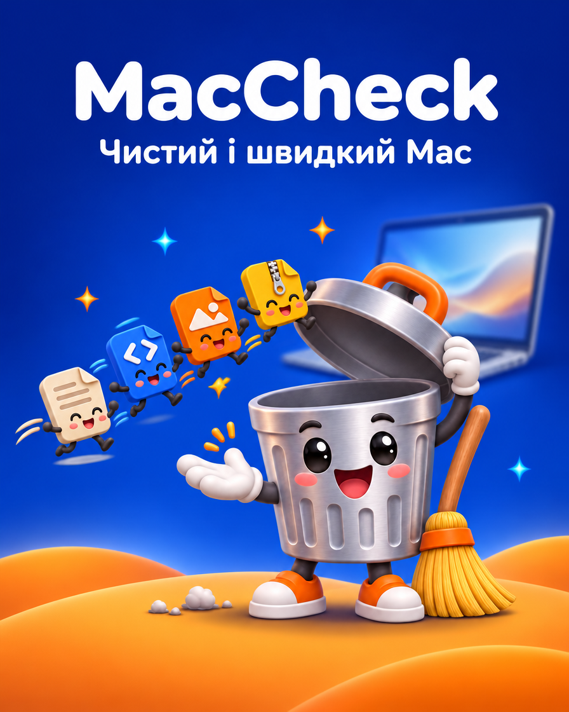

# MacCheck

Невелика програма, яка тримає Mac чистим і швидким. Українською та англійською, для Mac на Apple Silicon (M1 і новіші), macOS 13 або новіша.

*A small utility that keeps a Mac clean and fast. Ukrainian and English interface, Apple Silicon only, macOS 13 or later. English instructions are below.*

## Що вміє

- **Прибирає сміття.** Вилучає лише в Кошик, тож усе можна повернути. Системні файли й файли, якими зараз користуються програми, не показує взагалі.
- **Звільняє пам'ять.** Ставить на паузу програми, що її з'їдають. У Chrome та схожих браузерах «присипляє» лише фонові вкладки: вікно й завантаження працюють далі.
- **Показує, що гальмує.** Монітор у рядку меню, список фонових програм із поясненнями простими словами.
- **Нічого нікуди не надсилає.** Без ШІ, без облікового запису, працює без інтернету.

## Завантажити

Останній інсталятор — у розділі [Releases](../../releases/latest): файл `MacCheck-4.0.dmg`.

## Як встановити

Програма поки не підписана сертифікатом Apple, тому при першому запуску Mac покаже попередження «Not Opened» («Не відкрито»). Це очікувано.

1. Відкрийте `.dmg` і перетягніть MacCheck у «Програми».
2. Запустіть MacCheck. У вікні попередження натисніть «Готово» (Done).
3. Відкрийте «Системні параметри» → «Приватність і безпека». Унизу, в розділі «Безпека», натисніть «Усе одно відкрити» (Open Anyway).
4. Підтвердьте паролем або Touch ID.

Це потрібно зробити лише раз. Кнопка «Усе одно відкрити» з'являється тільки після спроби запуску.

## Як отримати ключ

Програма працює з кодом доступу. Зараз коди видаються вручну й безкоштовно, на обмежений термін.

1. Запустіть програму: вона покаже вікно «Доступ до програми».
2. Скопіюйте «Код цього Mac» (вигляду `K7Q2-9FXM`).
3. Надішліть його авторові.
4. Отриманий код доступу (починається з `MC1.`) вставте у вікно й натисніть «Відкрити доступ».

Код доступу діє лише на тому Mac, для якого виданий. «Код цього Mac» — це скорочений відбиток: у ньому немає ні серійного номера, ні імені комп'ютера. Перевірка відбувається на самому Mac, без інтернету.

---

## English

### Install

The app is not yet signed with an Apple certificate, so macOS shows a "Not Opened" warning on first launch.

1. Open the `.dmg` and drag MacCheck to Applications.
2. Launch MacCheck and press **Done** in the warning.
3. Open **System Settings → Privacy & Security**, scroll to **Security** and press **Open Anyway**.
4. Confirm with your password or Touch ID.

### Get an access code

Codes are currently issued by hand, free of charge, for a limited term.

1. Launch the app; it shows the "Access to the app" window.
2. Copy **This Mac's code** (looks like `K7Q2-9FXM`).
3. Send it to the author.
4. Paste the access code you receive (it starts with `MC1.`) and press **Unlock**.

A code works only on the Mac it was issued for. The Mac's code is a short digest with no serial number or computer name in it, and it is checked on the Mac itself, offline.

---

© Усі права застережено. Вихідний код не публікується.
